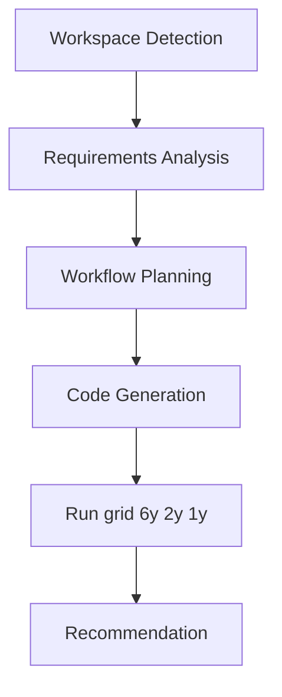

# Execution Plan — AlphaMom Top-N POC

## Recommended Stages
| Stage | Decision | Depth | Reason |
|-------|----------|-------|--------|
| Workspace Detection | Done | — | New directory, greenfield |
| Reverse Engineering | SKIP | — | No code in this directory |
| Requirements Analysis | Done | Minimal | Grid specified; ranking assumed dual-mom |
| User Stories | SKIP | — | Research backtest, no UX personas |
| Workflow Planning | Done | Minimal | Single script |
| Application Design | SKIP | — | No services |
| Units Generation | SKIP | — | One unit |
| Per-unit design | SKIP | — | Logic in requirements |
| Code Generation | EXECUTE | Standard | Grid backtest + recommendation |
| Build and Test | EXECUTE | Minimal | Synthetic ranking test + live grid run |

## Workflow Visualization

Text alternative:
1. Workspace Detection (greenfield)
2. Requirements (minimal assumptions)
3. Workflow Planning
4. Code Generation
5. Run the grid on 6y / 2y / 1y
6. Write which Top-N and cadence to pick
